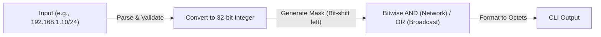

# IPv4 Subnet Calculator

A Python command-line utility that calculates network parameters from an IPv4 address in CIDR notation. Built entirely using manual bitwise operations to demonstrate a low-level understanding of IP addressing, networking fundamentals, and continuous integration.

## Contents

* [Why I built this](#why-i-built-this)
* [Product thinking](#product-thinking)
* [Features](#features)
* [Demo](#demo)
* [Core Logic](#core-logic)
* [Tech stack](#tech-stack)
* [Design decisions and trade-offs](#design-decisions-and-trade-offs)
* [Getting started](#getting-started)
* [Testing and CI](#testing-and-ci)
* [Project structure](#project-structure)
* [Roadmap](#roadmap)
* [What I learned](#what-i-learned)
* [Author](#author)

## Why I built this

While Python has built-in libraries (like the `ipaddress` module) that can handle subnetting automatically, I wanted to build this tool from scratch to deeply understand the binary mathematics that power the internet. By forcing myself to parse the IP addresses and manually shift bits to find the network and broadcast addresses, I gained a much stronger grasp of networking concepts and continuous integration workflows.

## Product thinking

**Problem.** Calculating subnet masks, host ranges, and broadcast addresses by hand is tedious and prone to human error, especially for non-standard CIDR blocks (like `/23` or `/27`).

**Users.** Network engineering students, IT professionals, and developers who need quick, reliable IPv4 network validation in their terminal.

**User stories**

1. As a user, I type an IP address with a CIDR notation (e.g., `10.0.0.1/24`) and get a detailed network breakdown.
2. As a user, I see the usable host range so I know which IPs can be assigned to devices.
3. As a user, I get a clear error if I enter an invalid IP (e.g., octets over 255) or an invalid CIDR (e.g., `/33`).

**In scope:** CIDR parsing, input validation, binary/bitwise calculation, CLI output.
**Non-goals (for now):** IPv6 support, Variable Length Subnet Masking (VLSM) table generation, GUI.

## Features

* Parses IPv4 addresses in standard CIDR notation.
* Calculates Network Address, Subnet Mask, Wildcard Mask, and Broadcast Address.
* Determines the first and last usable host IPs, total addresses, and usable hosts.
* Gracefully handles edge cases (like `/32` host routes and `/31` point-to-point links).
* Comprehensive input validation to catch malformed addresses.
* Fully tested via `pytest` and automated with GitHub Actions.

## Demo

**Standard Usage:**

```bash
python calculator.py 192.168.1.10/24
```

**Output:**

```text
Network 192.168.1.0 Mask 255.255.255.0 Wildcard 0.0.0.255 Broadcast 192.168.1.255 First host 192.168.1.1 Last host 192.168.1.254 Total addresses 256 Usable hosts 254
```

## Core Logic

Instead of relying on abstract libraries, this application converts the dotted-decimal IP address into a raw 32-bit integer to perform manual bitwise math.



1. **IP to Binary:** `192.168.1.10` becomes `11000000 10101000 00000001 00001010`.
2. **Subnet Mask:** A `/24` creates a 32-bit integer with 24 leading ones and 8 trailing zeros.
3. **Network Address:** Calculated using a bitwise `AND` (`&`) between the IP and the Mask.
4. **Broadcast Address:** Calculated using a bitwise `OR` (`|`) between the IP and the inverted Mask (`~`).

## Tech stack

| Layer | Choice | 
| ----- | ----- | 
| Language | Python 3.12 | 
| Interface | Command-Line Interface (CLI) | 
| Validation | Built-in string manipulation and integer casting | 
| Tests | `pytest` | 
| CI | GitHub Actions | 

## Design decisions and trade-offs

| Decision | Why | Trade-off | 
| ----- | ----- | ----- | 
| Manual Bitwise Operations | To deeply understand networking logic at the processor level, rather than relying on Python's `ipaddress` module. | More complex code to write, debug, and maintain. | 
| Command-Line Interface | Keeps the tool lightweight and fast for IT environments where a terminal is preferred. | Less accessible for users who prefer graphical interfaces. | 
| Raw String Parsing | Allows for precise, custom error messages (e.g., pointing out a specific invalid octet). | Slightly more verbose than using a complex Regex pattern. | 

## Getting started

### Requirements

* Git
* Python 3.12 or newer

### Run locally

macOS / Linux / Windows:

```bash
git clone https://github.com/Youssef/subnet-calculator.git
cd subnet-calculator
python calculator.py 192.168.1.10/24
```

## Testing and CI

```bash
pytest -v
```

The test suite thoroughly verifies the manual bitwise logic against Python's built-in modules to ensure 100% mathematical accuracy across all edge cases.

**Test Output:**
```text
test_subnet.py::test_matches_ipaddress_module[192.168.1.10/24] PASSED [ 8%] 
test_subnet.py::test_matches_ipaddress_module[10.0.0.0/8] PASSED [ 16%] 
test_subnet.py::test_matches_ipaddress_module[172.16.5.4/30] PASSED [ 25%] 
test_subnet.py::test_matches_ipaddress_module[8.8.8.8/32] PASSED [ 33%] 
test_subnet.py::test_matches_ipaddress_module[10.1.1.1/31] PASSED [ 41%] 
test_subnet.py::test_matches_ipaddress_module[0.0.0.0/0] PASSED [ 50%] 
test_subnet.py::test_usable_hosts_for_slash_24 PASSED [ 58%] 
test_subnet.py::test_invalid_input_raises[192.168.1.10] PASSED [ 66%] 
test_subnet.py::test_invalid_input_raises[300.1.1.1/24] PASSED [ 75%] 
test_subnet.py::test_invalid_input_raises[10.0.0.0/33] PASSED [ 83%] 
test_subnet.py::test_invalid_input_raises[abc/8] PASSED [ 91%] 
test_subnet.py::test_invalid_input_raises[1.2.3/24] PASSED [100%]

========================= 12 passed in 0.09s =========================
```

GitHub Actions is configured to run this test suite automatically on every push and pull request.

## Project structure

```text
subnet-calculator/
  calculator.py      # Core logic and CLI entry point
  tests/
    test_subnet.py   # Pytest test cases
  .github/workflows/tests.yml
  README.md
```

## Roadmap

* [ ] Add a VLSM (Variable Length Subnet Mask) generator.
* [ ] Support for IPv6 parsing and prefix calculation.
* [ ] Add an optional JSON output flag (`--json`) for use in automated shell scripts.

## What I learned

* **Bitwise Arithmetic:** Translating networking concepts into raw binary shifts, ANDs, and ORs solidified my understanding of how computers actually process IP routing.
* **Continuous Integration:** Successfully implementing GitHub Actions to run my `pytest` suite, ensuring my binary logic never broke when I refactored the code.
* **Edge Case Handling:** Realizing that strict mathematical rules break down for `/31` and `/32` subnets, requiring special conditional logic to handle host availability accurately.

## Author

Built by [Youssef Khairy](https://github.com/Youssef), Computer Engineering student at the University of Central Florida.